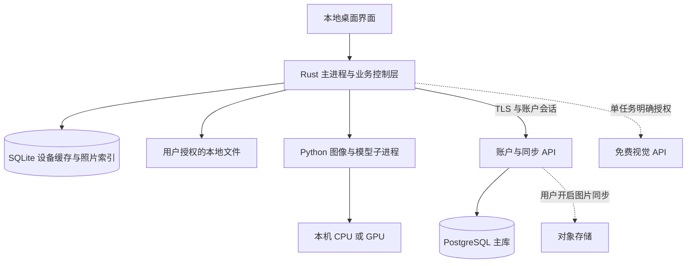

# 整体框架：Windows 桌面应用

> 规划日期：2026-09-14。本文是整体技术与产品约定，尚未实现。首发按 Windows 11 x64、Microsoft Store 方向制定；Android/iOS/macOS 不在首版交付范围。硬件数据来自本机读取，性能和发布兼容性仍需验证。

## 1. 产品形态与核心决策

Vision Analytics Studio 是可以安装、从开始菜单启动、有独立窗口、能访问用户选定文件的桌面软件。界面和基础功能安装在用户电脑上，断网仍可使用已安装的本地能力。

四个工作区分别是植物与农业、实验室、虚拟穿搭、个人相册。共同使用本地素材库、任务中心、模型中心、设置和账户体系。正式发行版先完成真实账户与云端主数据库；视觉计算仍优先在用户设备执行，免费 API 或配对计算设备只作明确授权的补充。

| 决策 | 首版方案 | 原因 |
| --- | --- | --- |
| 桌面外壳 | Tauri 2 | 复用系统 WebView，提供窗口、文件与进程能力 |
| 界面 | React＋TypeScript＋Vite，构建产物随安装包分发 | 适合图片工作台；运行时不依赖在线网站和前端开发服务器 |
| 系统与业务入口 | Rust 主进程，窄范围 Tauri commands | 统一文件权限、任务状态、模型进程生命周期 |
| 图像与模型 | Python 打包的独立进程 | 复用模型生态，避免模型崩溃带走界面 |
| 云端主数据 | PostgreSQL，所有业务表按 `user_id` 隔离 | 账户、设备、同步设置与云记录的权威来源 |
| 设备缓存 | SQLite，业务控制层单一写入入口 | 保存离线缓存、设备照片索引和本地任务，不承担跨设备权威数据 |
| 模型与素材 | 本地文件＋版本化清单 | 按需下载权重，不把所有模型塞进首个安装包 |
| 账户 | 正式版必须注册／登录；开发构建允许标识清晰的本地旁路 | 云操作必须有有效会话，离线只使用最近账户的受控缓存 |
| 云能力 | 用户选择的免费视觉 API；默认本地 | 免费能力是补充，不能成为基础功能的单点依赖 |

这些是本规划的建议决策，不代表框架已经经过打包或性能实测。版本号在技术验证通过后锁定，不在规划里追求“全部最新版”。

## 2. “内置浏览器驱动”究竟是什么

| 名称 | 实际作用 | 本项目是否需要 |
| --- | --- | --- |
| WebView2 | 在 Windows 原生窗口内绘制 HTML/CSS 界面 | Tauri Windows 版使用它；用户不需要打开浏览器标签页 |
| Chromium | 浏览器渲染引擎；Electron 会随应用带入相关运行时 | 只有选择 Electron 才走该打包方式 |
| ChromeDriver／Selenium／Playwright | 自动操作浏览器，常用于测试或网页自动化 | 不作为正式产品运行依赖；开发测试工具也不放入用户安装包 |
| NVIDIA 显卡驱动 | 让本地 GPU 执行模型 | GPU 功能需要兼容驱动，与浏览器驱动完全不同 |

Tauri 在 Windows 使用基于 Edge 的 WebView2，Electron 则把 Chromium 和 Node.js 放进应用。采用网页界面技术不等于交付网页产品；本方案所有核心页面本地打包，不把远程网站直接包成一个窗口。[Tauri WebView 说明](https://v2.tauri.app/reference/webview-versions/)、[Electron 官方介绍](https://www.electronjs.org/docs/latest)

外部帮助、资料来源和未来 OAuth 登录使用系统默认浏览器打开。主窗口不加载任意远程页面，不让外部网页调用本地文件或进程接口。

## 3. 框架比较与选择门槛

| 方案 | 优点 | 本项目的代价 | 结论 |
| --- | --- | --- | --- |
| Tauri＋React＋Python | 界面表现力与本地能力兼顾；系统 WebView 可复用 | 需学习少量 Rust；Python/GPU 打包与商店发布要早验证 | 首选 |
| Electron＋React＋Python | JS 生态成熟，桌面整合资料多 | 额外 Chromium/Node 运行时，需承担更新与资源开销 | 如果团队确实只熟悉 JS，作为替代；不同时维护两套 |
| C# WPF／WinUI＋Python | Windows 原生交互与系统集成直接 | 另需 C#/XAML 技术栈，图片编辑界面工作仍存在 | 若 Tauri 集成成本明显过高，再单独评估 |

第一周必须验证四件事：启动真实桌面窗口、选择中文路径图片、启动打包的 Python 子进程完成一个小任务、安装包在干净 Windows 环境运行。还要做一条 MSIX 包装试验，防止到最后才发现分发路线不适配。

Tauri 小外壳不等于完整 AI 软件只有几 MB。Python、PyTorch、CUDA 用户态依赖、模型权重可能占用 GB 级空间；安装页分别显示“软件本体、模型运行组件、模型权重”的实际下载量和磁盘需求。

## 4. 进程与数据流



界面负责交互和展示；主进程负责校验、持久化、路由和进程控制；Python 负责计算并返回结构化结果。界面不直接运行任意 shell 命令，Python 不直接修改账户数据库。

Tauri 支持把额外可执行程序作为 sidecar 打包，官方也列出了 Python／PyInstaller 场景。具体科学计算依赖能否打包仍须测试，不能以“支持 sidecar”推导“任何模型直接可分发”。[Tauri sidecar 文档](https://v2.tauri.app/develop/sidecar/)

默认通信采用主进程与子进程间的 JSONL 标准输入／输出协议。每条消息包含 `protocol_version、request_id、task_id、event_type、payload`；日志写 stderr，stdout 只放协议消息。处理半条消息、背压、超时和子进程退出。

图片传受控素材 ID 对应的文件引用，结果先写临时文件，校验后原子提交。避免在 IPC 中反复传输整张 Base64 大图。临时路径由主进程分配，模型输出路径不能任意写入系统目录。

如果某个第三方模型只能运行本地 HTTP 服务，才使用环回地址、随机端口与会话令牌的适配器；不监听 `0.0.0.0`，不把本地端口当成天然可信。默认架构不依赖 FastAPI 常驻 Web 服务。

## 5. 通用契约与模块边界

| 公共服务 | 对模块暴露的能力 |
| --- | --- |
| AssetService | 导入、读取预览、派生文件、导出、引用、删除与来源记录 |
| TaskService | 提交、校验、排队、取消、恢复、进度事件与结果登记 |
| ModelManager | 设备检测、下载／导入、许可状态、加载卸载、能力与版本查询 |
| ProviderRouter | 按任务类型、数据策略和预算选择本地或已授权 API |
| ProfileService | 当前工作区、云身份关联、设置与凭据引用 |
| AnnotationService | 人工标签与掩膜修订、版本、撤销与重做 |

模块声明自己的输入 schema、输出 schema、可用模型、资源配置和支持格式。所有模块都遵守公共状态机，不分别实现不同的任务队列或文件删除逻辑。

公共结果至少包含 `schema_version、source_asset_ids、provider、model_id、model_revision、parameters、warnings、created_at`。科学统计再加单位和校准；生成图片再加种子及生成标记；云结果再加实际传出数据摘要和调用用量。

## 6. 任务系统与资源调度

状态主路径：`queued → running → succeeded / failed / cancelled`。`running` 带具体阶段；`cancel_requested` 是独立标记。输入错误在执行前拒绝；模型缺失进入可修复的配置状态，不伪装成排队成功。

- 单卡先只允许一个 GPU 任务；界面可同时管理多个任务，但不代表模型并行生成。
- CPU 轻量检查设有界线程池；相册批任务低优先级，每完成一张后给交互任务让出机会。
- 不把所有模型常驻内存。按模块加载，切换时退出旧模型子进程释放显存；批量任务可在资源允许时短期复用进程。
- 任务记录先入 SQLite，再开始计算；程序重启时把中断任务标为可重试，不能宣称从扩散采样中途恢复。
- 内容哈希、输入修订、模型版本与参数决定缓存键；只在同一工作区内复用缓存。
- OOM 仅允许一次有依据的低显存配置重试；没有已验证配置则停止，不自动付费或下载新模型。
- 关闭窗口时给出“退出并停止任务／继续在托盘运行”的明确选择；不默认开机自启，不阻止系统休眠。

硬件基线：当前开发机 RTX 5060 Laptop 约 8GB 显存、16GB 内存。基础相册应在无独显电脑可用；GPU 模块按检测结果显示可用范围。Mac、AMD、Intel GPU 不承诺直接复用 CUDA 模型。

性能预算是待验证目标：不加载模型时主界面启动 P95 ≤5 秒；界面和常规元数据服务总内存争取 ≤500MB（含 WebView 子进程，以固定小型素材库测量）；模型加载和推理单独计量。模型启动不能阻塞首页。

## 7. 安装包、模型包与本地路径

开发环境可以使用 Python 虚拟环境。用户版必须能在没有 Python、Git、Node、Conda、Visual Studio 的干净机器上使用基础功能，不能让普通用户执行 pip 安装或命令行配置。

先验证带完整依赖的 Python onedir 发行方式，避免科学计算环境每次启动都解压大包。首版模型运行组件随可分发软件包交付；模型权重按需下载。独立 GPU 扩展组件若采用额外安装包，应另行验证商店允许的分发与更新方式，不能通过下载任意脚本执行来补功能。

模型状态：`未安装／下载中／校验中／可用／不兼容／损坏／许可待确认`。清单记录权重 URL、字节数、SHA-256、适配器版本、依赖许可、设备条件；下载可暂停，空间不足先阻止，文件校验完成后才原子切换。

优先使用无需执行代码的数据格式；遗留权重若采用可能反序列化代码的格式，只接受核验的可信来源和固定哈希，不开放“任意网上模型一键运行”。用户导入离线权重必须匹配已知模型清单。

| 目录类型 | 规划 |
| --- | --- |
| 程序文件 | 安装包目录，只读使用；不把数据库或用户照片写入这里 |
| 业务数据 | 通过系统应用数据目录 API 获取，包含 profiles、数据库、任务清单 |
| 模型缓存 | 用户可选择磁盘的受控目录；共享模型数据，分工作区隔离结果 |
| 用户素材 | 分析素材由用户主动复制导入；设备相册只索引经选择器授权的目录，不复制原图 |
| 凭据 | 操作系统凭据存储；SQLite 只保留凭据引用 |

数据目录迁移使用复制→校验→切换引用→用户确认后清理旧目录，不能直接跨盘移动导致中途损坏。升级前备份数据库，迁移失败停止写入并保留旧版恢复路径。

## 8. 权限与本地数据保护

仅申请当前窗口需要的 Tauri capabilities：打开文件、选定目录读取、指定导出、通知和受控 sidecar。文件路径规范化并校验边界，拒绝路径穿越和越权的符号链接／目录跳转。模型输出和图片内文字都当作数据，不当作系统指令。[Tauri 权限机制](https://v2.tauri.app/security/capabilities/)

本地缓存按云账户分区，绝对路径、缩略图和设备目录授权永不上传。访问令牌只驻留内存，刷新凭据放 Windows 凭据存储；SQLite 不保存密码、令牌或对象存储签名 URL。“退出账户”会撤销本机会话并锁定该账户缓存，但不把锁定描述成安全擦除。

用户照片默认不进入训练集。网络能力按模块和服务授权，可撤销；默认清理云请求副本的定位信息。网络外传策略和免费额度细节见 [模型与成本](06-models-and-cost.md)。

## 9. 4 核／2GB 账户与数据服务器

服务器无需部署桌面界面和视觉模型。初期放反向代理、轻量账户／同步 API 和 PostgreSQL；图片二进制不进入 PostgreSQL。用户明确开启云图片同步后，客户端从 API 获取短期签名地址并直传对象存储，数据库只保存对象键、哈希、大小、状态和归属。完整安全与删除方案见 [云端数据与安全](08-cloud-data-security.md)。

使用场景分开：

1. **默认公众用户**：注册登录后使用客户端，视觉处理在自己的电脑进行；服务器短时不可用时仅开放已验证账户的缓存与本地任务，暂停同步和账户变更。
2. **用户自己的第二台计算机**：后续通过一次性配对码建立明确授权的远程 Worker，任务使用租约、心跳和幂等提交。
3. **开发者笔记本**：仅自用和明确限额的小规模内测；不会自动接收所有商店用户的照片或任务。
4. **公共免费 API 中转**：只有条款允许且具有真正免费硬限制时才开放小额配额；开发者共享密钥只在服务器保管。

图片云同步默认关闭。2GB 系统盘不保存图库原件；对象存储设用户配额、生命周期和删除队列。配对 Worker 如必须中转图片，采用短期对象、容量上限和到期清理；设备离线显示等待恢复，用户可以取消，不用开发者机器自动接管。

免费 API 允许的任务直接调用官方接口，不内置浏览器自动登录免费聊天网站。个人凭据走本机安全存储，不在软件安装包中硬编码开发者 API key。

## 10. 工程目录与基础验收

建议后续代码结构如下；本轮只创建规划文件：

```text
apps/desktop/                # React 界面与 src-tauri 主进程
engine/                      # Python worker 与四模块适配器
contracts/                   # 版本化任务、结果与 IPC schema
services/account/            # 正式版账户与同步服务
packaging/                   # Windows 安装、MSIX、组件清单
evaluation/                  # 固定评测与失败样本清单
tests/                       # 关键集成与桌面生命周期检查
docs/                        # 本轮规划文件
```

基础框架验收：干净 Windows 安装、无管理员日常运行、无 Python 环境运行、中文与长路径、高 DPI、断网启动、任务进程崩溃恢复、用户取消、磁盘不足、升级迁移、正常卸载、模型依赖缺失时保留相册可用。

第一版不以成功打包为“已经上架”。MSIX、应用签名、模型再分发权、隐私说明和审核材料分别验证；具体发布门槛见 [发布与路线图](07-release-roadmap.md)。
