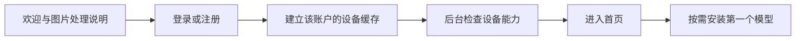

# 首次启动、登录注册与首页规划

> 适用：Windows 桌面版。日期：2026-09-14。真实注册、登录、当前账户与退出界面，以及对应 FastAPI 认证服务已有第一版；邮箱验证、恢复、凭据持久化和正式部署仍按本文推进。公共能力以 [整体框架](00-overall-architecture.md) 为准。

## 1. 体验目标与账户边界

用户第一次打开软件，应在一分钟左右理解“能做什么、图片是否上传、离线时能做什么”。正式发行版把注册／登录作为进入个人工作区的前置步骤；模型下载和 API key 配置仍按需进行，不能串成一个冗长流程。

开发构建保留带醒目标识的本地旁路，供账户服务器上线前调试。商店构建删除该入口。最近成功登录的用户断网时可解锁该账户的本地缓存并运行本地模型，但不能注册、修改安全信息、创建云同步或把离线缓存身份当成在线授权。

| 概念 | 含义 | 不应混淆的内容 |
| --- | --- | --- |
| 设备缓存 | 该账户在本机的素材索引、任务和部分设置 | 不是权威数据库，退出后锁定，换账号不混用 |
| 云账户 | 服务器验证的注册身份与数据归属 | 登录不会自动上传图库；同步必须单独开启 |
| API 凭据 | 用户自己向模型服务商申请的 key | 与本软件账户密码分开，退出云账户可选择是否清除它 |
| 计算设备配对 | 授权指定电脑执行自己的任务 | 不代表可以访问那台电脑所有文件 |

未部署账户服务器时只发布开发／内测构建，登录页明确显示“开发模式”；不得把模拟登录、固定验证码或跳过认证的包提交软件商店。

## 2. 首次启动流程

欢迎页只展示应用定位、四个工作区和“开始使用”，不播放耗资源的全屏动画。默认提供系统应用数据目录，并告诉用户可以更换模型存储盘。

选择目录时检查可写性和可用磁盘。用户跳过设备检测也能进入首页；检测结果异步更新能力卡。发现无 CUDA 显卡时展示 CPU 可用功能，不把整个软件判定为不能运行。

模型下载只在用户选择模块后发起。显示下载量、目标目录、许可摘要和可用设备条件；可稍后安装或导入官方兼容离线包。首次打开不自动下载几 GB 文件。

## 3. 登录与注册页面

推荐首版云账户采用邮箱＋密码＋邮箱验证／重置链接。若邮件服务暂时没有预算，可在封闭内测使用用户名＋一次性恢复码；公开发行前必须提供用户能理解且可用的找回流程。短信登录不列入首版，避免持续费用和号码隐私负担。

| 页面 | 字段与动作 | 异常与反馈 |
| --- | --- | --- |
| 登录 | 邮箱、密码、显示密码、登录、注册、忘记密码 | 账号或密码错误合并提示；断网只允许已登录过的账户进入离线缓存 |
| 注册 | 邮箱、显示名称、密码、确认密码、服务条款与隐私政策 | 邮箱占用不用于公开枚举；重复点击使用幂等键，不重复创建 |
| 注册成功 | 展示一次性恢复码并提示安全保存 | 用户主动确认已保存；码不再次明文显示，不发送到分析日志 |
| 恢复账户 | 用户名＋未使用的恢复码＋新密码 | 成功后撤销旧会话、轮换恢复码；失败限速，避免枚举账户 |
| 账户中心 | 显示名称、登录设备、修改密码、重新生成恢复码、退出与注销 | 修改凭据和注销需要最近验证；注销与删除本地素材分开说明 |

邮箱规范化后做唯一性约束；显示名称允许中文且独立于登录 ID。单因素密码最短 15 个字符，至少支持 64 个字符、空格和 Unicode；允许粘贴与密码管理器，不设无意义的大小写／符号组合规则，不要求无风险事件时定期改密。注册和改密时与常见／泄露密码阻止列表比对。

该口径依据当前 [NIST SP 800-63B](https://pages.nist.gov/800-63-4/sp800-63b.html)；实施前再核对版本，不能把客户端校验当作服务端安全控制。

服务器使用 Argon2id 和每个密码独立随机盐；初始参数采用 19MiB 内存、2 次迭代、并行度 1，再在 2GB 服务器上按实际登录延迟调优但不低于该基线。登录、注册、重置和恢复码验证同时做账户级与 IP／设备级限速，限制密码哈希并发，避免少量内存被耗尽。恢复码高熵生成、只存哈希、单次使用，不采用“回答生日”等安全问题。

Argon2id 的初始下限来自 [OWASP Password Storage Cheat Sheet](https://cheatsheetseries.owasp.org/cheatsheets/Password_Storage_Cheat_Sheet.html)。生产参数需在目标服务器上测量并记录，升级参数时在下一次成功登录后重哈希。

访问令牌有效期建议 10–15 分钟，只驻留进程内存；随机刷新令牌按设备保存服务端哈希，每次使用都轮换，并检测旧令牌重放后撤销整条令牌家族。本机刷新凭据放 Windows Credential Locker／系统凭据存储，日志、SQLite 和 WebView 存储不保存密码或令牌。所有接口只走 TLS；服务端密钥从秘密管理或受限环境变量加载并支持轮换。

如果后续增加第三方登录，采用系统浏览器与标准授权流程，回调校验状态及 PKCE；软件不要求输入 Microsoft/Google 的账户密码，也不需要浏览器驱动。

## 4. 工作区、登录状态与退出行为

云会话状态：`未登录／登录中／待验证邮箱／已登录／离线已解锁／会话失效`。离线解锁只针对本机最近成功验证且未被本地标记撤销的账户，不授权新的云操作；恢复网络后必须刷新会话再同步。

本地默认工作区与云身份关联时，只关联身份和设置，不自动上传任何素材。另一云账户登录时进入独立工作区；可以显式导入旧工作区素材，但不自动混合。业务层所有任务和文件引用都携带 `workspace_id`。

退出前若有云调用或配对任务，提示其状态并撤销后续云请求权限；已经发出的请求可能不能取消，完成结果仍归原工作区，不泄露到下一个账户。退出不会静默删除照片。

注销云账户会撤销会话、停止配对、删除云端账户数据并反馈清理状态。页面同时提供“另外清理本机工作区”的独立选项；离线设备上的缓存无法即时远程抹除，应如实说明。

## 5. 首页信息结构

默认窗口建议 1280×800；最小布局按 1024×720 验证。适配 Windows 缩放 100%–200%、深浅主题、键盘导航和系统高对比度；首次使用沿用系统主题。

| 区域 | 主要内容 | 交互 |
| --- | --- | --- |
| 顶栏 | 应用名、全局搜索、任务按钮、账户入口、原生窗口按钮 | 任务数量是实际活跃任务数，账户菜单显示在线／离线／需重新登录 |
| 左侧导航 | 首页、植物与农业、实验室、虚拟穿搭、个人相册；底部模型中心与设置 | 保留当前位置、支持键盘访问，图标配文字 |
| 首页上方 | “导入图片”与“继续上次任务”两个主要动作 | 导入后让用户选择工作区，不自动外发或调用模型 |
| 四模块卡片 | 用一句话说明结果，显示可用／需安装模型／实验功能 | 卡片可查看说明；不支持时提供安装或输入条件入口 |
| 最近活动 | 最近任务、结果与素材，各显示少量项目 | 继续、查看、定位文件；空状态提供授权示例 |
| 底部简况 | 设备可用能力、磁盘空间、后台任务 | 显存诊断和技术版本留在高级详情 |

首页不默认展示病害率、模型准确率等无用户数据的假数字，不把所有技术日志摆在普通用户面前。无可用模型时展示“先整理照片”与“安装一个模型”，让基础软件仍有价值。

## 6. 统一交互规范

导入使用系统文件选择器、文件夹选择器或拖拽。使用“导入／保存到文件”而非网站式“上传／下载”描述本地动作；实际调用云服务时明确使用“发送至某服务分析”。

所有工作区共用以下组件：文件预览、输入质量提示、任务状态、结果来源标签、保存对话框、操作撤销、空状态和可恢复错误。

开始任务前只展示会影响用户决策的信息：处理位置、是否联网、免费额度状态、预计等待、输入范围。用户选择过的本地默认配置不反复确认；更换服务或新增外发数据类型才更新授权。

缩略图点击进入大图查看，双击行为一致。`Ctrl+O` 导入，`Ctrl+F` 搜索，`Esc` 退出预览，`Ctrl+Z` 撤销可逆标注；各模块明确焦点范围，避免一键误删源文件。

## 7. 模型中心与设置

模型中心按“能解决什么任务”展示卡片，而不是只列模型代号。每张卡显示下载大小、设备要求、许可状态、是否离线、适用模块、安装／更新／移除。详细版本与校验在高级页。

设置分组：通用外观、数据与备份、计算与电源、网络与免费 API、账户与设备、隐私、关于与许可证。

计算设置提供“优先节省资源／均衡”两档已验证配置，不暴露一长串未经测试的采样参数。电池供电时提示生成耗时和耗电，默认不启动后台批处理；用户可主动运行单次任务。

API 设置显示“当前本地处理”“某服务免费层可用”“额度无法确认”等真实状态；免费剩余额度没有可靠查询时不编造数字。提供移除密钥、撤销图片外发许可和切回本地。

## 8. 页面状态与可访问性验收

| 场景 | 预期行为 |
| --- | --- |
| 首次安装、断网、无模型 | 无法创建新账户；说明需要联网完成首次登录，不无限等待或伪造登录 |
| 已登录设备断网、无模型 | 可进入该账户本地缓存和相册索引；云同步与安全设置暂停 |
| 注册服务器未部署或停机 | 开发构建显示开发模式；商店构建不得发布不可用的强制登录入口 |
| 忘记密码 | 有恢复码可重置；无恢复方式给出诚实提示 |
| 下载中退出、重启 | 已下载部分可校验后继续，损坏文件不标为可用 |
| 切换云账户 | 不展示上个工作区的任务和缩略图 |
| GPU 任务失败 | 页面可继续操作，有失败原因和修正入口 |
| 只用键盘／高 DPI | 按钮名称可被辅助技术读取，无遮挡，焦点顺序清楚 |
| 关闭主窗口有任务 | 用户决定退出或托盘继续，结束后不会留失控子进程 |

## 9. 实施切分

1. 2–3 天：窗口、导航、四卡首页、空状态和按账户分区的设备缓存原型。
2. 3–5 天：系统导入、最近任务、公共结果预览和模型中心状态。
3. 3–5 天：连接真实本地任务、退出／恢复、设置持久化和设备检测。
4. 5–8 天：真实注册登录、邮箱验证／恢复、Argon2id、限流、令牌轮换、设备会话和客户端安全存储。
5. 3–5 天：云端用户数据同步、冲突规则、导出／注销删除、审计与备份恢复演练。

以上为单开发者的初步估算，公共任务与素材实现另见整体里程碑。账户服务延期时继续开发桌面端，但不提交要求登录却没有真实服务的发行版。
