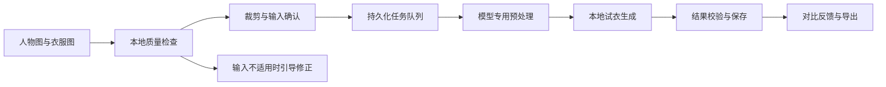

# 虚拟穿搭模块规划

> Windows 桌面版；更新：2026-09-20。主路线是用户自己电脑上的本地推理。当前开发机为 RTX 5060 Laptop 8GB／16GB 内存；图片质量检查、人体与服装语义预检、FASHN VTON v1.5 本地生成和 SD 1.5 Inpainting 局部手部候选均已接入。流水线先生成完整服装，再逐侧核验上臂、前臂和手，必要时只修复失败侧，并用原图同位置或相邻前臂校正肤色。整体约束见 [应用框架](00-overall-architecture.md)，免费服务策略见 [模型与成本](06-models-and-cost.md)。

## 1. 产品边界

核心输入是**目标人物照片和目标衣服照片**，核心输出是保留人物身份与姿态、呈现该衣服外观的二维效果图。V1 服务普通用户尝试外观，不做电商真实版型承诺；算法成功生成与用户认可效果分开统计。

试穿效果只用于外观参考。单张照片不能可靠提供真实三围、服装版型参数和布料物理属性，因此不输出“尺码合适”“一定显瘦”或真实松紧程度。第一版不要求用户导入身高体重。

| 版本 | 支持范围 | 开放条件 |
| --- | --- | --- |
| V0 技术验证 | 授权的规范人像＋平铺上衣；命令行或简单验证界面 | 在本机跑通且可重复评估 |
| V1 核心体验 | 单人正面站姿；单件 T 恤、衬衫、薄款上衣；单张结果 | 达到质量与稳定性门槛 |
| V1.1 类别扩展 | 下装、连衣裙分别上线 | 每个类别独立完成评测，不以“模型参数支持”代替验收 |
| V2 衣橱与搭配 | 收藏衣服、标签、搭配组合、有限的多件试穿 | 单件稳定，且多件流程有独立质量证据 |
| 远期探索 | 外套叠穿、鞋包饰品、视频或三维试衣 | 独立立项和预算评估 |

输入框可以接受全身照，但上衣模式还允许清晰的正面半身照：人物至少从头部到髋部完整可见。全身照中上身过小时，引导裁剪到合适范围；原图始终保留。

当前本地模型的能力边界必须在生成前执行，不能用增加推理步数掩盖不适用输入：

| 输入场景 | 当前处理 | 原因与用户动作 |
| --- | --- | --- |
| 清晰近景人物＋单件衣服 | 允许生成并执行服装、左右肢体、肤色和持物核验 | 当前主支持路径 |
| 模特同时穿着上衣与背带裤、内搭与外套等叠穿参考图 | 预检阻止 | 模型容易把多件衣服拆散或叠到原衣上；改用单件平铺／挂拍图 |
| 人物有效区域小于画面约 12% | 预检阻止 | 手指、衣领和纹理像素不足；先裁剪，使人物至少约占画面四分之一 |
| 手臂交叉、手持物、手完全被衣服遮挡 | 允许尝试但结果必须核验 | 不可见身体只能生成合理外观，不能还原真实皮肤和饰品 |
| 多件同时换装、厚外套叠穿 | 暂不作为稳定能力 | 需单独的多服装数据集、区域保护和顺序评测 |

## 2. 用户完整流程

1. **准备人像**：导入自己的照片，或选用已获授权的内置示例；显示正面站姿、手臂稍离躯干等拍摄示例。
2. **选择衣服**：导入单件衣服正面图，或从自己的衣橱选择；确认衣服类型，V1 仅开放上衣。
3. **检查和修正**：检查清晰度、人数、遮挡和目标区域；给出具体修正建议，必要时裁剪或重新导入。
4. **确认输入预览**：展示实际送入模型的裁剪图；需要掩膜的模型同时展示将被修改的区域。
5. **提交生成**：任务进入本地队列，显示排队／预处理／生成／保存；切换工作区不丢失任务；退出软件时明确停止或托盘继续。
6. **检查结果**：并排或滑块对比原图与结果，并保留衣服参考图，支持放大看领口、袖口和图案。
7. **处理不满意结果**：用户选择“脸变了／衣服不像／手部异常／原衣残留”等反馈；可修正输入或主动再次生成。
8. **保存与管理**：导出效果图或明确选择保存到相册；保留输入关联、参数、模型版本和生成标记，支持删除。

## 3. 输入规范与照片质量处理

以下大小与清晰度要求是产品初始规则，需要用真实手机照片校准，不能当作模型通用定律。

| 输入 | 推荐要求 | 处理方式 |
| --- | --- | --- |
| 人物 | 单人、正面或轻微转身、自然站立、均匀光照；短边建议至少 768px | 识别人像区域并建议裁剪；目标躯干过小或模糊则提示重拍 |
| 姿势 | 肩部与躯干可见，手臂稍离身体 | 手臂交叉、大面积长发遮挡、包遮挡胸前时给出明确提示 |
| 原穿着 | 普通合身上衣，轮廓清楚 | 厚外套换短袖、宽大衣服换紧身衣列为困难输入 |
| 衣服 | 单件、正面、铺平或挂平、边缘完整；简单背景优先 | 裁掉电商文字、边框和其他商品；不强制所有模型都使用抠图 |
| 文件 | V1 支持 JPEG/PNG/WebP，单张暂限 15MB、解码后不超过 2400 万像素 | 验证真实格式、损坏文件、方向与色彩；HEIC 后续单独适配 |
| 特殊服装 | 透明、反光、复杂蕾丝、超大廓形、密集文字图案 | 首版不保证效果，测试集单列；明显超出范围时不提交 |

质量检查分三层，尽量将成本花在有效生成上：

- **文件与图像检查（CPU）**：解码、尺寸、EXIF 方向、曝光与模糊度；保护性地限制总像素，不能只检查文件大小。
- **人物与服装语义检查（本地解析）**：在加载扩散模型前检查人物有效区域和服装组成。人物区域低于约 12%，或模特参考图同时出现明显上衣与连体／背带结构时直接阻止，避免等待一到三分钟后才得到不可用结果。平铺图不套用模特叠穿规则。
- **人物与区域检查（轻量检测／姿态）**：OpenCV Haar/HOG 给出人物候选数量与占比提示；未检测到只警告，多人候选阻止提交。人体解析和手部姿态负责生成后的逐侧完整性核验。
- **用户确认**：预览和示例帮助用户判断；模糊度等启发式阈值允许“建议修正”，确定无效的输入才阻止提交。

不通过生成式修复补出缺失身体后再当作真实试穿输入。普通降噪或缩放也应保留原图与处理记录；无法恢复的细节直接反馈给用户。

## 4. 本地模型选型

首轮只比较两个候选，避免大量安装模型而迟迟无法交付。候选均需先核对权重、依赖许可及本机兼容性。

| 路线 | 已核实的信息 | 本项目中的位置 |
| --- | --- | --- |
| FASHN VTON v1.5 本地模型 | 人物图＋衣服图；支持上衣、下装、连体装；默认无需用户提供分割掩膜。模型卡列出 576×864 输出、约 8GB 推理显存，主模型为 Apache-2.0 | 已作为开发评测适配器接入；8GB 笔记本单样例成功，仍需固定集质量、峰值显存、连续运行与许可验收 |
| CatVTON | 官方提供本地流程、自动掩膜工具及约 8GB 级推理说明；代码与权重为 CC BY-NC-SA 4.0 | 非商业研究／演示的对照候选；用于比较图案保真与可控掩膜流程 |
| IDM-VTON | 官方代码与检查点为 CC BY-NC-SA 4.0 | 暂列后备，不作为低成本首版必装项 |
| 免费视觉理解 API | 可补充衣服属性描述或输入检查意见，具体候选见模型与成本规划 | 仅按用户选择调用；返回文字不等于能生成试衣图 |
| 托管试衣 API | 需要独立核实图像生成能力、免费层、条款和收费模式 | 当前没有经本项目验证的持续免费试衣后端，不作为零预算基础依赖 |

依据：[FASHN 模型卡](https://huggingface.co/fashn-ai/fashn-vton-1.5)、[CatVTON 官方仓库](https://github.com/Zheng-Chong/CatVTON)、[IDM-VTON 官方仓库](https://github.com/yisol/IDM-VTON)。候选能力来自官方说明；下方单独列出的数据才是本项目实测。FASHN 开源 v1.5 与其托管服务不是同一部署方案。

### 当前开发机实测

| 项目 | 结果 |
| --- | --- |
| 运行环境 | Windows 11、Python 3.13.5、PyTorch 2.11.0+cu128、CUDA、BF16 |
| 固定版本 | FASHN 源码 `7c0f10a`；主模型 `7720683`；DWPose `548b5df`；Human Parser `1f80c34` |
| 本地文件 | 主模型＋DWPose＋Human Parser 共 2,550,960,249 字节，逐文件校验 SHA-256 |
| 单样例生成 | 官方人物／服装示例，上衣、模特图、20 步、seed 42，成功输出 576×864 PNG |
| 时间 | 模型脚本约 33 秒；桌面端冷启动完整链路约 59.4 秒，包括预检、三个组件加载、生成和保存 |
| 运行位置 | 主模型和 Human Parser 使用 RTX 5060 Laptop GPU；当前 DWPose 使用 CPU ONNX Provider |
| 数据外发 | 生成阶段强制 Hugging Face 离线模式；缓存不完整时失败，不在任务中自动联网下载 |

这次结果证明本机单样例链路可行，尚不能证明真实用户照片质量、连续稳定性或 P95 时延。复现环境使用 `scripts/setup-tryon-evaluation.ps1`；版本和哈希见 `models/tryon/manifest.json`。

**FASHN 的依赖许可需单独处理**：官方仓库列出了 Human Parser；该组件声明继承 SegFormer 的许可，后者包含非商业研究／评估用途限制。因此不能仅凭主模型的 Apache-2.0 就认定完整默认流水线可商用。若未来商业化，应确认实际执行依赖、取得相应授权或替换受限组件，并重新评测；“maskless”也不等于整套代码没有解析器依赖。[FASHN 依赖说明](https://github.com/fashn-AI/fashn-vton-1.5)、[Human Parser 许可](https://github.com/fashn-AI/fashn-human-parser/blob/main/LICENSE)、[SegFormer 许可](https://github.com/NVlabs/SegFormer/blob/master/LICENSE)

选型规则：FASHN 已通过本机单样例可运行性验证，下一步按固定评测集检查质量、连续稳定性与峰值显存；若不满足门槛，再比较 CatVTON。最终只把一个许可和质量均通过的主模型接进发行版。不能用当前成功样例代替产品可行性。

这里的首选只指**技术评测顺序**，不是商店默认分发许可已通过。个人研究包与商店发行包使用分开的能力清单：研究候选不进入商店包，也不通过“让用户自己下载”绕开许可判断。免费上架不自动等于非商业研究用途。

商店模型开放条件：记录主代码、主权重、姿态/解析器、基础模型、示例图片的独立来源与条款；明确允许对应分发和使用场景；在干净机器上通过安装与质量验收。如果替换受限组件，需要新建流水线版本并重新评估；没有通过的能力不在商店宣传成已支持。

## 5. 推理流水线

### 长袖换短袖与遮挡补全

当前工作区采用可追踪的分阶段流水线：

- **服装优先生成**：先用 segmentation-free 路线生成完整服装主体，避免为修手破坏裙装、图案和轮廓。
- **左右分开核验**：画面左右两侧分别检查上臂、前臂、手部解析面积、21 点手部结构、手指延伸和局部清晰度；不能再用“附近存在少量皮肤像素”代替完整手判断。
- **遮挡判定**：原图的手部关键点还要得到人体解析像素支持；关键点落在口袋或衣服上时视为姿态模型的推测，标记为原手遮挡，不能直接复制回结果。
- **按需二次候选**：只有某侧肢体未通过才串行运行第二候选；候选先在内存局部合成并重新核验，清晰度没有真实提高或引入服装破坏时自动拒绝并回退第一阶段。
- **独立手部补全**：服装结果仍缺手时，卸载试衣任务后在隔离环境加载本地 SD 1.5 Inpainting，沿该侧肩、肘、腕建立宽手掌区域并生成四个局部候选。每个候选只合并颜色连续的最大皮肤区域，过滤规则线纹，再重新执行逐侧关键点、手长、自然细节、肤色和服装检查。
- **同位置肤色参考**：每侧上臂、前臂和手先取原图同位置的可信皮肤；覆盖不足时依次回退到同侧其他可见皮肤和面部。使用面部与手部颜色锚点过滤被人体解析器误标为皮肤的花纹衣袖，分段校正量做空间平滑，避免肘部色带。
- **原物保护**：只有经关键点和解析像素共同确认真实可见的手才恢复原像素；手机使用紧区域分割保护，不连带复制原衣服。

实验模式能生成视觉上合理的手臂，但原图没有记录被遮挡区域，因此任何模型都不能恢复真实皮肤、纹身、伤痕、手表或饰品。结果页和任务记录保留 `sleeve_mode`、`generation_passes`、逐侧质量分数与遮挡说明。正面站立、手臂与躯干分开、双手可见的输入通常更稳定；交叉手臂、手持物、严重侧身和手臂出画会提示较高失败风险。

当前 FASHN 实测可以生成完整手臂，但对原手几乎完全遮挡的小尺寸手部有时只产生低细节拳状区域。项目已接入独立的本地 SD 1.5 Inpainting 手部补全链：仅对失败侧生成四个候选，拒绝缺指、手掌过窄、骨段比例异常、肤色偏差和高频线纹结果，保留另一只手、手机与服装阶段结果。局部肤色优先匹配修复区紧邻且未修改的同侧前臂；该位置没有可信皮肤时才回退到同侧皮肤或面部。RTX 5060 Laptop 8GB 单样例已通过，四候选约 24 秒、峰值显存约 2677 MiB；单样例通过不代表各种姿态稳定，未通过固定测试集前继续标记为实验能力。权重使用 OpenRAIL-M，进入商店包前还必须完成组合依赖、权重来源、磁盘体积和分发许可审查。[Stable Diffusion inpainting 模型卡](https://huggingface.co/stable-diffusion-v1-5/stable-diffusion-inpainting)

公共流程负责素材和任务管理；模型适配器负责各自的缩放、类别映射、姿态、掩膜和推理参数。不把某一个模型的预处理要求写死在全平台。

对于需要掩膜的路线：先生成试衣区域，保留人脸、头发及不应修改的区域，提供简单画笔增删掩膜。生成区域必须允许新衣服合理扩展，不能把原衣轮廓当成不可突破的边界。掩膜编辑只在对应适配器支持时开放。

对于不要求用户掩膜的路线：直接使用官方流程，先通过裁剪与规范输入提高成功率，不额外串接一套未经验证的分割流程。

输出处理只做必要的尺寸、格式和完整性检查。不要默认对结果执行人脸重绘或生成式超分；这可能改变身份或衣服细节。若提供后续美化，应另外保存并标记为衍生版本。

## 6. 显存、延迟和失败恢复

- 预处理与生成分阶段执行，结束后释放临时模型和张量；GPU 模型不能在多个应用子进程中重复加载。
- 先采用模型官方支持的分辨率、单样本和合适精度；内存优化逐项验证，不能假设所有模型都支持任意降分辨率、量化或 CPU 卸载。
- 当前机器先争取“可稳定生成”，再优化速度。建议把预热后单图 P95 不超过 180 秒设为初始可用性目标，最终根据用户体验和实测决定是否接受。
- 若 OOM，清理或重启模型子进程；仅在存在已验证的低显存配置时自动重试一次，并记录配置变化，否则返回明确失败原因。
- 队列中任务可以立即取消；运行中只有模型支持时才能中断，否则标记取消请求并在结束后清理结果，避免杀掉共享服务。
- 同一用户的重复提交通过幂等键去重；再次生成是显式的新任务，使用新种子。相同种子也不保证跨设备、跨版本逐像素一致。
- 不因低质量结果无限自动重试，不把失败偷偷转成收费调用。

## 7. 试衣质量评测与上线门槛

V0 先准备 20 组授权输入进行安装和效果冒烟测试；候选可运行后建立固定评测集，至少含 **100 组范围内上衣组合＋30 组困难／应拒绝输入**。人物、衣服及照片来源尽量多样；同一个人的照片和同一件衣服不能横跨调参集与最终验收集。

以下门槛为初始目标，允许在预实验后调整一次并冻结。所有结果都计入报告，不能只挑选成功样例。

| 维度 | 评测方式 | V1 建议门槛 |
| --- | --- | --- |
| 人物保留 | 人工对比面部、发型、姿态和体型；明显变脸为严重错误 | 严重身份改变不超过范围内任务的 5% |
| 衣服保真 | 颜色、领型、袖型、图案和主体结构分别评分 | 综合可接受比例 ≥80%；文字和复杂纹理单列 |
| 视觉完整 | 手部、衣领、遮挡边缘、原衣残留 | 严重结构错误不超过 10% |
| 综合可用率 | 身份、衣服、视觉完整三项均通过的结果／全部范围内任务，技术失败也计入分母 | ≥75%，并报告样本数和不确定性 |
| 运行稳定 | 同一预设连续运行 30 次，含模型切换场景 | 无进程崩溃、无未处理 OOM，无持续内存增长 |
| 时间与资源 | 分别统计冷启动、预处理、排队、生成的 P50/P95 和内存／显存峰值 | 在实际硬件上满足冻结后的资源与等待目标 |
| 无效输入 | 30 组困难输入中区分“确实应拒绝”和“可提示后尝试” | 所有确定无效文件拒绝；误拒绝和漏检单独统计 |

尽量由两名评审独立打分，分歧再复核；若只有一人，报告中说明局限。自动相似度仅辅助筛查，不能证明穿着尺寸准确或保证人物身份未改变。

失败样本按原因进入迭代清单：输入不合格 → 改导入引导；掩膜不合理 → 改预处理；图案漂移 → 评估主模型；显存不足 → 调整运行配置。每轮优先解决占比最高的一类问题。

## 8. 从试衣扩展到穿搭

先做本地衣橱：衣服图片、类别、颜色、季节、风格、用户备注和收藏。搭配建议优先通过用户确认的标签和简单规则生成，再由本地语言模型润色说明；不凭空生成衣橱中不存在的商品。

“搭配推荐”与“试穿生成”是两个功能：前者决定选哪些衣服，后者生成视觉效果。推荐卡片可以先上线，不依赖整套换装模型。

多件换装不能简单保证“先换上衣再换裤子”可靠：后一次生成可能改坏前一件衣服或人物。需要保存原始人像、各阶段输入和中间结果，比较不同顺序与区域保护策略；未通过独立验收前只展示单件试穿与搭配拼图。

## 9. 桌面界面与原生交互

工作区采用三栏：左侧人物与衣服输入，中间结果画布，右侧类别、质量提示与历史版本。窗口较窄时右栏折叠，不缩小关键图像到无法辨认。

| 视图 | 必需能力 | 空／错误状态 |
| --- | --- | --- |
| 双图输入 | 文件选择、拖拽、从相册选取、裁剪与替换 | 未导入显示授权示例；一张图不满足时说明缺少什么 |
| 输入检查 | 可用区域预览，建议重拍的位置 | 多人、方向错误、身体缺失、衣物复杂等具体建议 |
| 生成画布 | 原图／结果切换、滑块对比、缩放、参考衣服固定显示 | 队列可取消；失败保留输入与已选设置 |
| 历史版本 | 每次结果有独立缩略图、时间与输入关联 | 改衣服不会覆盖旧结果，不以旧图冒充新任务成功 |
| 保存面板 | 导出原始生成分辨率、另存为、保存到相册 | 文件冲突选择改名或明确覆盖；保存失败不丢当前结果 |

第一版不显示随机种子、推理步数和掩膜扩张值等研究参数；需要时放高级设置，并仅开放验证过的范围。视图中的“高清”不能只是把低分辨率图插值放大。

## 10. 数据与任务接口

任务类型 `tryon.generate`：输入为 `person_asset_id、garment_asset_id、category、crop_revision、mask_revision?、preset、seed?`。主进程根据模型能力补齐参数，而不是把界面自由文本直接作为任意模型指令执行。

输出为 `result_asset_id、pipeline_revision、input_revisions、actual_resolution、seed、timings、quality_warnings`。视觉评价单独记录 `identity、garment_fidelity、artifacts、user_satisfaction`，不把用户满意当成尺寸适配证明。

衣橱实体 `Garment` 保存图片、类别、可修订标签和来源；会话 `TryOnSession` 把人像、衣服和多次生成关联起来；反馈 `TryOnFeedback` 不修改原结果。用户手动画的掩膜也有版本号。

模型能力声明包含支持的类别、原生分辨率、掩膜方式、最低已测硬件、是否可取消、许可状态。未通过能力检查的任务不能进入 GPU 队列。

## 11. 存储、外发与恢复

导入默认复制原图到工作区，不改动用户外部原文件。试穿输入、派生裁剪、结果和缩略图分别引用管理。未保存临时会话可在完成 24 小时后清理；主动保存的会话保留，具体清理设置可见。

同一个人的人像默认不发送给免费视觉 API。若只需要衣服标签，最多发送去除无关信息的衣服裁剪，按供应商说明与用户授权处理；导入本地图片不代表同意外发。

重启后恢复输入和任务记录；生成中断的任务可以重新执行，不承诺从某个扩散步骤续算。因用户取消而丢弃的临时结果不能被历史页面重新显示。

## 12. 本模块实施与成本控制

| 阶段 | 估计工作量 | 交付与停点 |
| --- | --- | --- |
| T0 技术验证 | 4–7 个工作日 | 一条真实本机流水线、20 组输入、显存与失败记录；运行不稳定时先处理环境 |
| T1 输入与任务 | 4–6 个工作日 | 双图、裁剪、质量建议、本地队列与恢复；复用公共导入和画布 |
| T2 对比与数据 | 3–5 个工作日 | 历史版本、结果对比、导出、衣服保存与反馈 |
| T3 独立验收 | 4–7 个工作日 | 固定 100＋30 组测试、性能报告、分发许可核验与发行配置 |

工作量不含大量标注或训练，与公共框架部分重叠，不能机械相加为固定上线日期。衣橱搭配扩展另排，不在首版单件闭环中无限增加功能。

一次只生成一张；再次生成明确新任务；检查结果图细节优先于自动多抽样。普通电脑无合适 GPU 时允许衣橱管理和查看已有结果，显示试衣硬件要求，不通过开发者笔记本免费兜底所有用户。

本模块最终可交付证据：可复现模型清单、真实案例与失败案例、独立评测报告、干净 Windows 运行记录、各输入类别支持表、权重和依赖分发结论。尚未通过时按研究功能交付给内部测试，不宣称已经具备商店发行条件。
