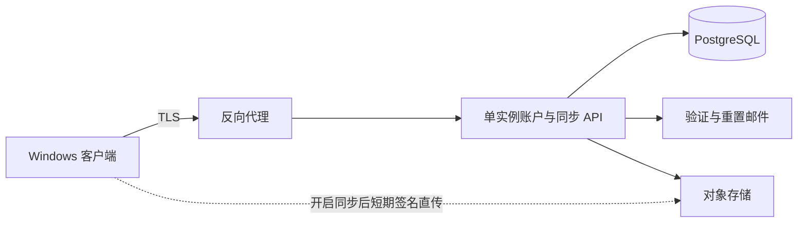

# 云端数据、登录与图片安全实施规划

> 日期：2026-09-14。适用于正式 Windows 发行版。目标是在 4 核／2GB 低成本服务器上提供真实账户与权威数据库，同时让视觉计算和设备图库默认留在本机。接口草案见 `contracts/cloud-api.openapi.yaml`，数据库初稿见 `server/schema.sql`。

## 1. 数据边界

PostgreSQL 保存账户、设备会话、设置、分类偏好、同步版本、对象键和审计事件，是云端业务数据的权威来源。本机 SQLite 是按账户分区的离线缓存、设备照片索引和任务队列。冲突时依据服务端版本号、修改时间和字段级规则合并，绝不能整库覆盖。

图片二进制不存 PostgreSQL。设备照片原件默认不上传；用户单独开启云同步并选择范围后，客户端取得短期签名地址直传对象存储。数据库只保存随机对象键、内容哈希、字节数、媒体类型、状态和 `user_id`。对象键不得包含邮箱、原文件名、设备路径或分类名称。

永不上传：设备绝对路径、文件夹名称、Windows 用户名、未授权 EXIF、GPS、OCR 文本、人脸模板、密码、访问／刷新令牌、对象存储签名 URL。模型训练默认关闭，不能把“提供服务”扩展解释为训练授权。

## 2. 最小部署拓扑

4 核／2GB 可用于小规模内测，但需限制连接、密码哈希并发和请求体。建议 API 1 个实例，PostgreSQL 使用约 512–768MiB 可控内存，连接池 10–20，反向代理限制 JSON 请求和速率；视觉模型、图片转码、向量库和对象存储不放在该服务器。上线前用目标镜像压测 20 个并发登录、100 个空闲连接攻击、磁盘逼近和备份恢复，依据结果再调整。

## 3. 注册、登录与会话

注册流程：提交邮箱、显示名称、密码和幂等键 → 统一响应 → 发送一次性验证链接 → 验证成功后创建首个设备会话。登录失败统一返回，不暴露邮箱是否存在。密码单因素最短 15 字符，支持至少 64 字符、Unicode、空格与粘贴；检查泄露／常见密码，不设组合规则或任意定期轮换。该口径依据当前 [NIST SP 800-63B](https://pages.nist.gov/800-63-4/sp800-63b.html)。

密码使用 Argon2id，每条独立随机盐；初始下限为 19MiB、2 次迭代、并行度 1，来自 [OWASP Password Storage Cheat Sheet](https://cheatsheetseries.owasp.org/cheatsheets/Password_Storage_Cheat_Sheet.html)。登录、注册、重置按账户、IP 和设备分层限速，并限制同时执行的 Argon2id 数量。

访问令牌有效 10–15 分钟，只驻留客户端内存。刷新令牌为 256 位以上随机值，服务端只存哈希，绑定设备记录，每次使用轮换；旧令牌重放会撤销令牌家族。Windows 客户端把刷新令牌放系统凭据存储。改密、删除账户、查看恢复码等敏感操作要求最近验证。

## 4. 用户隔离与接口授权

每张用户业务表都有不可空 `user_id`。API 从已验证会话建立用户上下文，禁止接受请求体中的用户 ID 作为授权依据。所有读取、更新和删除同时按资源 ID 与当前用户过滤；找不到和无权访问统一响应。对象下载地址只能为当前用户生成，短期有效、限制方法和对象键。

PostgreSQL 开启并强制 Row Level Security 作为第二道防线；运行时数据库角色不能拥有表、不能带 `BYPASSRLS`，每个事务先设置 `app.user_id`。后台删除任务使用单独最小权限角色。任何新增表若没有归属策略，迁移检查直接失败。

## 5. 图片同步状态机

`local_only → upload_requested → uploading → uploaded → delete_requested → deleted`。客户端先创建元数据记录并取得单对象签名上传；上传完成后 API 通过对象存储元数据校验大小、类型和哈希，再把状态改为 `uploaded`。未完成上传在 24 小时后回收。

同步默认关闭并按来源／相册选择，页面预估图片数、容量和成本。分类可仅同步安全类别 ID；设备路径永不参与同步。用户关闭同步后停止新上传，已上传对象由用户选择保留或进入删除队列。

删除账户时先撤销全部会话，再冻结写入、导出清单、标记对象删除、清理业务行。对象存储删除和备份过期是异步过程，页面显示真实状态与最迟完成时间。删除任务幂等并可重试；审计日志只记录事件、主体、结果和请求 ID，不记图片内容、文件路径或凭据。

## 6. 加密、日志与备份

- 传输仅 TLS，开启 HSTS；客户端不提供忽略证书错误的生产开关。
- 数据库磁盘、备份和对象存储使用服务商静态加密；应用层敏感字段如有必要再做带版本的信封加密。
- 生产密钥、数据库密码、邮件密钥和对象存储密钥不进仓库、镜像或日志；按用途分开并支持轮换。
- 日志清除 Authorization、Cookie、密码、恢复令牌、签名 URL、完整邮箱、设备路径和请求图片；错误追踪使用请求 ID。
- PostgreSQL 每日加密备份并设置保留期；至少每月在隔离环境做一次恢复演练。未验证恢复前不能宣称“已备份”。

## 7. 分阶段交付与验收

| 阶段 | 交付 | 必须通过 |
| --- | --- | --- |
| C0 合同 | OpenAPI、SQL 迁移、威胁清单、数据字典 | 每个字段有归属、保留期和同步策略 |
| C1 账户 | 注册、邮箱验证、登录、刷新、退出、重置、设备撤销 | 枚举、暴力破解、重放、并发哈希和日志脱敏测试 |
| C2 同步元数据 | 类别偏好、版本游标、离线冲突、删除 | 两账户数据隔离；离线重放幂等；绝对路径不出现在网络请求 |
| C3 可选图片同步 | 配额、签名直传、校验、下载、删除队列 | 越权对象键、过期签名、超限、断点与删除恢复测试 |
| C4 生产准备 | 监控、告警、备份恢复、隐私政策、数据导出和注销 | 在目标 2GB 服务器压测；商店审核账户可用；恢复演练有记录 |

首发若 C1 未通过，就只发封闭开发构建，不提交强制登录的商店版。若 C3 未通过，账户与本地相册仍可发布，但界面不能展示云图片同步入口。
